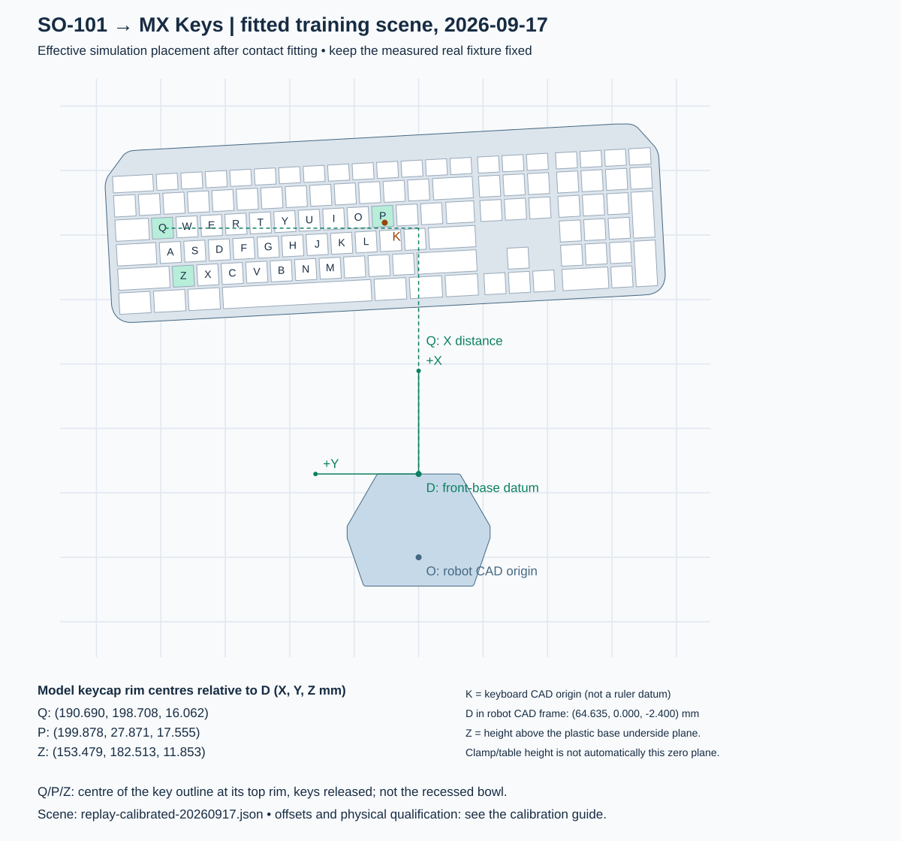

# Physical measurements and simulator layout reference

For the normal collect → calibrate → train workflow, use the
[short real-to-sim guide](docs/release/REAL2SIM.md) and `scripts/real2sim.sh`.
This page provides the measurement details and scene-drawing commands.

For training on your own layout, start with your own base-to-keyboard measurements.
To reproduce the released September NEWTON example, use its
[frozen physical setup instructions](docs/fixtures/physical_reference_20260915.md#physical-setup-used-for-the-september-newton-checkpoint).
Those describe the real placement; the fitted simulation coordinates are separate.

**Each bird's-eye drawing belongs to a specific saved scene.** The physical
reference, historical benchmark and current fitted training scene are different;
choose the labelled view below. A fitted scene's effective pose can compensate
for model differences, so its dimensions are not physical ruler targets. Keep
the actual fixture fixed while calibrating the model against recorded contacts.

Use this guide for the reference Logitech MX Keys geometry and the stock
`base_so101_v2` plastic SO-101 base. A clamp is fine if the base is rigid and its
mounting plane stays level. Measure the **plastic base**, not the clamp, table
edge, servo cover, or cable bracket. A different base, keyboard, typing jaw or
keyboard tilt needs geometry validation before these measurements are usable.

## Before policy training: verify the real scene

The typing policy has no vision of the physical keyboard pose. Establish the
robot/keyboard relationship from physical datums first, then test whether measured
real arm trajectories describe the same motion and contacts in that fixed scene.
**Hand-guided recordings are for scene and encoder/model validation, not policy
training or imitation learning.** An unexplained failure to reproduce those
contacts is a reason to resolve the model/mapping before task training.
The [calibration rationale](docs/release/REAL2SIM.md#why-recorded-motion-calibration-comes-before-training)
explains the observed discrepancy and why the effective keyboard pose and
joint offsets are fitted together while the physical fixture stays fixed.

| Step | Work | Evidence before proceeding |
| --- | --- | --- |
| 1. Calibrate, measure and freeze placement | Complete LeRobot calibration with the sweep clear, then match base-to-keyboard datums, lateral alignment and support plane using the guide below. Keep the keyboard, base and fixed jaw fixed. | Dated measurements, bird's-eye drawing and the exact task JSON; ruler agreement alone does not verify arm FK. |
| 2. Record real motion | Hand-guide the fixed jaw with torque off through A–Z presses/releases. Collect two or three recordings with the fixture and robot calibration fixed. | Measured follower angles, timestamps and USB key edges; robot/calibration/model identities. No policy or commanded trajectory is used. |
| 3. Fit the scene | Fit fresh joint offsets and an effective keyboard pose from recorded contacts; refine against Newton contacts. All five arm offsets are supported. Keep jaw geometry fixed and preserve the measured layout separately. | Per-key residuals, parameter bounds and a separate effective task JSON. Simultaneous pan/yaw estimates are not unique mechanical-zero measurements. |
| 4. Check recorded approaches | Reset between keys and replay each measured approach with the fitted scene and offsets. Require the intended first contact without simultaneous extra keys. | All recorded per-key checks pass. This is the original calibration criterion; continuous replay is a separate optional diagnostic. |
| 5. Train | Use the passing fit's task JSON and evaluate early. Keep the fitted mapping for deployment. | Saved training scene and policy evaluation. The recordings are calibration evidence, not PPO demonstrations. |
| 6. Verify and deploy physically | Check new recordings and policy-free Q/G/P hover/press/release commands using the same inverse mapping, then follow deployment qualification. | Independent contact/tracking/clearance evidence and the matching scene, policy and mapping. Simulation contact fitting alone does not prove physical policy performance. |

The September fitted scene passed 93/93 per-key contacts and supported one
[physical NEWTON trial](docs/release/RESULTS.md).
For your setup, use [alignment qualification](docs/release/ALIGNMENT.md) to check
reserved recordings and physical Q/G/P contacts before deployment.
Simulation-only setup checks can run earlier.

| Bird's-eye view | What it represents |
| --- | --- |
| [September 15 physical reference](docs/fixtures/physical-reference-birdseye-20260915.svg) | The unchanged datum-based starting layout; use its [measurement record](docs/fixtures/physical_reference_20260915.md) for physical cross-checks. |
| [September 17 fitted training scene](docs/fixtures/replay-calibrated-birdseye-20260917.svg) | The latest effective scene, selected after 93/93 per-key replay checks and used by `model_2498.pt` for the successful physical NEWTON trial. Its [task JSON](configs/tasks/replay-calibrated-20260917.json) preserves that example, not a universal user layout. |
| [Historical benchmark scene](docs/fixtures/reference-birdseye.svg) | The July scene used by the optional 19k policy. This is also the default `./so101 fixture` view and the Q/P/Z numerical example below. |

The [latest fitted simulation pose table](README.md#september-calibrated-scene-example)
gives the September 17 XYZ and orientation in the simulated robot-base frame.
The real base and keyboard remained frozen; the simulated pose was adjusted to
fit the recorded real contacts. The September 15 physical-reference view above
continues to describe the measured physical placement.



Joint offsets change the encoder-to-model arm pose. These drawings omit the arm,
so offsets alone do not move the base or keyboard outlines. Fitting a new keyboard
pose does change the outline and dimensions: the September 15 view therefore
does **not** depict the September 17 training scene. The physical keyboard stayed
fixed; use the [dated comparison](docs/fixtures/physical_reference_20260915.md#physical-reference-versus-fitted-training-scene) to see the model correction.

Draw any saved scene explicitly:

```bash
./so101 fixture --task-config output/my-scene/task.json --out-dir output/my-scene-view
```

Generated views use a 50 mm grid and omit the arm/clamp to expose the base datum.
They are model projections, not printable alignment templates or reachability maps.

## 1. Establish the robot measurement frame

Look down at the base. Its broad plastic outline must match the drawing. The
controller/cable bracket is behind the base; the straight front face is toward
the keyboard. If your base does not match, do not substitute the clamp outline.

Define **D** as the intersection of three planes: the frontmost flat face of the
plastic base, its left/right symmetry plane, and its flat underside plane. This
is a constructed measurement point; no hole or mark at D is required. Use a
straightedge against the front face, find its midpoint, and extend perpendicular
lines with a square onto paper/tape. Keep these lines fixed to the base.

| Measurement | Direction from D | How to measure |
| --- | --- | --- |
| X | Forward from the base toward the keyboard | Perpendicular distance from the front-face line; not a diagonal ruler distance |
| Y | Left when standing behind the robot looking toward the keyboard | Signed lateral distance from the base centreline; right is negative |
| Z | Up from the plastic base underside plane | Keycap rim height minus base-underside height, both measured from the same level reference |

The exact CAD offset of D is `(64.635455, 0, -2.400258) mm` in the robot-base
frame. The converter applies this offset. Do not enter these CAD coordinates
as your ruler readings. If the plastic underside is flush on the table, that
table is the height zero. If a clamp plate raises the base, measure and subtract
that height. Do not assume that clamping implies a particular height.


## 2. Measure Q, P and Z on the released keyboard

Secure the keyboard in the intended typing position, including the mat and feet
configuration. Use the fixed typing jaw with the moving jaw closed at deployment.
Identify the centre of each **keycap outline** on Q, P and Z. For height, use the
plane of the cap's top rim at that centre, not the recessed bowl or printed letter.
A straightedge across the rim helps establish this plane. Do not depress the keys.

Project each centre vertically onto the measurement plane (a square or plumb
reference helps) and record its X, Y and Z in millimetres. These are mechanical
landmarks for placement; they are not the policy's key-body target coordinates.
Do not use perspective distances from an uncalibrated photograph.

Create the drawing and a blank measurement form; this needs only host Python 3,
with no Docker build, GPU, calibration or robot connection:

```bash
./so101 fixture --out-dir output/reference-fixture
cp output/reference-fixture/measurement-template.json output/my-measurements.json
# Replace every null with your measured X, Y and Z in millimetres.
```

The form contains exactly three entries:

```json
{
  "Q": [null, null, null],
  "P": [null, null, null],
  "Z": [null, null, null]
}
```

The reference model predicts the following readings. **These are model values,
not measurements of your robot**; do not copy them into a measurement record.

| Key | X from D (mm) | Y from D (mm) | Z above D (mm) |
| --- | ---: | ---: | ---: |
| Q | 199.110 | 184.581 | 8.131 |
| P | 203.272 | 13.541 | 7.980 |
| Z | 161.205 | 169.519 | 7.117 |

These are **model predictions**, not measured physical setup dimensions. The
effective fitted transform explains the small Z values; it does not prove that
the physical keyboard sat at those heights. The historical `4.44 mm` mat and
`125.28 mm` edge gap do not fully specify the original mounting geometry. Do not
raise/lower hardware solely to match this table.

## 3. Fit a candidate simulation pose

```bash
./so101 fixture --measurements output/my-measurements.json \
  --out-dir output/my-fixture
# Inspect the candidate in simulation; this does not validate physical alignment.
./so101 probe --task-config output/my-fixture/task.json
```

Use this task as the measured reference for the
[recorded-motion scene calibration](docs/release/REAL2SIM.md). Preserve it, then
train using the separate task JSON produced by that calibration. The measurement
tool fits XYZ translation and full
orientation from the three measured landmarks, including keyboard tilt. It moves
the existing asset as one rigid object; its built-in key slope is preserved.
The output uses metres and an absolute `rotation_xyzw` quaternion. The simulator
moves the key target map with the asset and places its horizontal support plane
at the transformed case underside.

`measurement-report.json` records the inputs, source geometry hashes, pose and
per-key fit residuals. A maximum residual above **1 mm** rejects the fit before
creating output. This is a measurement-consistency check, **not** evidence that
a policy tolerates 1 mm placement error. Check axis signs, units, landmark
locations, base shape and keyboard dimensions on rejection. A different board
cannot be fixed by merely translating or rotating the CAD origin.

A successful three-point fit still does not prove the other keys, jaw, robot
calibration or contacts match. Check additional keys across the board against
the model and inspect the simulation probe before training or physical use.

To draw an existing nominal task pose instead of fitting measurements:

```bash
./so101 fixture --task-config output/my-fixture/task.json \
  --out-dir output/my-fixture-review
```

Drawings and `expected-landmarks.json` show the nominal pose only, not randomized
reset samples. Output directories must be new, protecting existing measurements.

## 4. Keep the two deployment workflows distinct

- **Train for your fixture:** validate the candidate scene and joint mapping
  against physical poses/contacts, train and evaluate, then export the matching
  `params/env.yaml` and joint mapping. Re-measure if the base or board moves.
- **Use a released checkpoint:** standard physical use requires your robot's
  qualification against that policy's frozen scene. A new measurement file does
  not reposition its map. Only the historical ~19k pair selects a mapping
  automatically for software-only export; the September policy requires an
  explicit mapping. Neither drawing certifies physical reproduction.

In both cases, perform standard LeRobot calibration for **your** SO-101.
Calibration determines encoder coordinates; it does not register the keyboard
or compensate for a raised clamp plate. Unknown checkpoints require a measured
joint fit or an explicit verified convention; there is no default zero-offset
mapping for newly trained policies.
Follow [hardware preparation](docs/release/HARDWARE_PREPARATION.md) for calibration,
export, the offline deployment dry run and the operator-controlled execution gate.
Start physical validation under supervision after checking geometry and reset
alignment. The helper never opens a serial device or commands the robot.

## Geometry provenance and limits

The drawing comes from the pinned robot USD used by the Docker runtime and the
repository's MX Keys asset. [model_geometry.json](docs/fixtures/model_geometry.json)
contains their hashes, the reference pose, base outline and keycap rim centres.
The helper checks the local keyboard/configuration hashes before using it.
`python3 scripts/build_fixture_geometry.py --output FILE` regenerates the asset
inside the pinned simulator container (numpy, scipy and USD/pxr required there only).

The historical 19k/default reference pose is `(262.5651584, 12.1353200, 1.7813943) mm`,
with quaternion XYZW `(-0.0309082351, 0.0307819167, -0.6977733512, 0.7149891643)`.
This is separate from the September 17 fitted pose linked above.
Its CAD yaw is not a physical squareness reading. Measured fits replace this
orientation; legacy relative-yaw task files retain it. See
[task configuration](docs/release/TASK_CONFIGURATION.md).

## Train and deploy with the fitted scene

Use the measured `task.json` with the [record → fit → train workflow](docs/release/REAL2SIM.md).
Use [alignment qualification](docs/release/ALIGNMENT.md) for reserved-recording
replay and physical Q/G/P probes before deployment.
