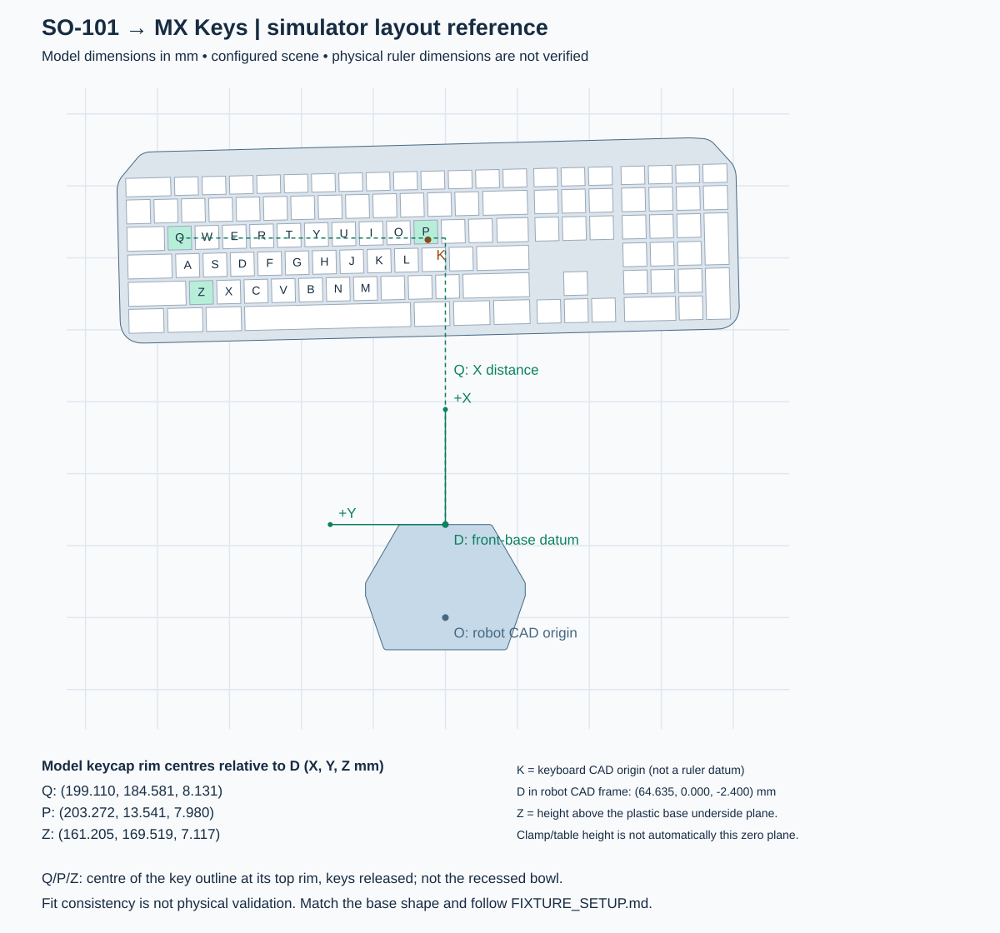
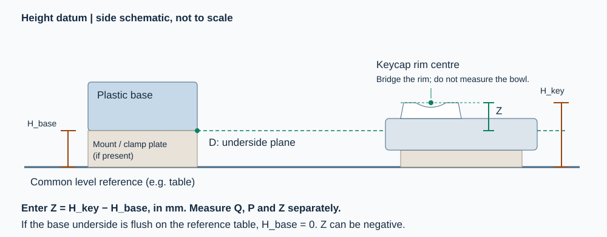

# Physical measurements and simulator layout reference

Start with your own base-to-keyboard measurements. The
[September 15 reference](docs/fixtures/physical_reference_20260915.md) is a dated
example for the ongoing mapping investigation, not the required layout for a
new user.

**The bird’s-eye drawing shows the fitted simulator scene, not a verified IRL
placement template.** The July scene's joint offsets and keyboard pose were fitted
together from physical contacts. Its effective tilt/height can compensate for
model differences, so model dimensions cannot all be treated as ruler targets.
The helper creates candidate simulation layouts; physical joint and contact
alignment still need independent measurements.

Use this guide for the reference Logitech MX Keys geometry and the stock
`base_so101_v2` plastic SO-101 base. A clamp is fine if the base is rigid and its
mounting plane stays level. Measure the **plastic base**, not the clamp, table
edge, servo cover, or cable bracket. A different base, keyboard, typing jaw or
keyboard tilt needs geometry validation before these measurements are usable.

## Before policy training: verify the real scene

The typing policy has no vision of the physical keyboard pose. Establish the
robot/keyboard relationship from physical datums first, then test whether measured
real arm trajectories describe the same motion and contacts in that fixed scene.
**Hand-guided recordings are for scene and encoder/model validation, not policy
training or imitation learning.** An unexplained failure to reproduce those
contacts is a reason to resolve the model/mapping before task training.

| Step | Work | Evidence before proceeding |
| --- | --- | --- |
| 1. Measure and freeze placement | Match base-to-keyboard datums, parallel edges, lateral alignment and support plane using the guide below. Keep the keyboard, base and fixed jaw fixed. | Dated measurements, bird's-eye drawing and the exact task JSON; ruler agreement alone does not verify arm FK. |
| 2. Record real motion | Calibrate this robot with LeRobot, then use the Python recorder with torque off. Hand-guide the fixed jaw through complete presses/releases across A–Z. Collect a separate repeat reserved for validation. | Measured follower angles, timestamps and USB key edges; robot/calibration/model identities. No policy or commanded trajectory is used. |
| 3. Check and fit the mapping | Replay direct angles first. If a correction is needed, jointly fit constant offsets for shoulder pan, shoulder lift, elbow flex and wrist flex on the fit recording only. Hold wrist roll, jaw geometry and keyboard placement fixed. | Zero/historical baselines, four-joint candidate, per-key residuals and sensitivity to samples. Do not move the keyboard to absorb a joint discrepancy. |
| 4. Validate without refitting | Replay the reserved recording with the candidate frozen. Inspect the jaw path, intended key down/up, missed/extra keys and worst-case residuals. | An exact press/release sequence across the reserved coverage; an average FK error or attractive viewer alone is insufficient. A retuned candidate needs new withheld data. |
| 5. Verify physical commands | Test policy-free hover/press/release at separated keys such as Q/G/P, one at a time, with the same mapping inverted on hardware writes. | Physical key down/up, no unintended contacts and measured tracking/clearance logs. This checks the commanded-motion direction separately from measured-pose replay. |
| 6. Train and deploy | Train in the validated model scene, evaluate early, then export its matching environment and verified mapping. | Saved scene/model/calibration/mapping identities plus the separate policy evaluation and hardware evidence. |

Choose contact/position tolerances from key geometry and measurement uncertainty
before inspecting validation results. The steps above are a documented workflow;
the training CLI does not enforce them. Simulation-only installation checks can
run earlier, but do not qualify a physical setup.

**Current limitation, 2026-09-17:** fitting joint offsets with the September
placement fixed has not achieved reliable physical typing. The historical 89%
benchmark used both an effective keyboard pose and joint offsets; it was not
proof of literal tabletop reconstruction. The next
[trajectory-based alignment experiment](docs/experiments/mapping_plan_20260916.md#trajectory-based-scene-alignment--2026-09-17)
compares pose-only, offsets-only and combined fits on separate scene candidates,
with validation on recordings excluded from fitting. Preserve the measured
placement as the reference; disclose any effective-model correction separately.

Use [the alignment qualification workflow](docs/release/ALIGNMENT.md) to freeze
one mapping, replay reserved measurements, test Q/G/P physically and export the
passing evidence. Standard physical policy execution requires that evidence; the alignment guide also documents explicit supervised candidate experiments. The current
development robot's reserved replay still has an extra contact and a miss, so
its fitted mapping remains unqualified. See [the investigation status](docs/experiments/README.md).



For the current dated physical-reference candidate and its side-gap dimensions,
use the [2026-09-15 physical-reference bird's-eye drawing](docs/fixtures/physical-reference-birdseye-20260915.svg).

[Open the full-size drawing](docs/fixtures/reference-birdseye.svg). It is a model
projection, not a printable alignment template or a reachability map. The grid
spacing is 50 mm. The arm and clamp are omitted so the base datum is visible.

## 1. Establish the robot measurement frame

Look down at the base. Its broad plastic outline must match the drawing. The
controller/cable bracket is behind the base; the straight front face is toward
the keyboard. If your base does not match, do not substitute the clamp outline.

Define **D** as the intersection of three planes: the frontmost flat face of the
plastic base, its left/right symmetry plane, and its flat underside plane. This
is a constructed measurement point; no hole or mark at D is required. Use a
straightedge against the front face, find its midpoint, and extend perpendicular
lines with a square onto paper/tape. Keep these lines fixed to the base.

| Measurement | Direction from D | How to measure |
| --- | --- | --- |
| X | Forward from the base toward the keyboard | Perpendicular distance from the front-face line; not a diagonal ruler distance |
| Y | Left when standing behind the robot looking toward the keyboard | Signed lateral distance from the base centreline; right is negative |
| Z | Up from the plastic base underside plane | Keycap rim height minus base-underside height, both measured from the same level reference |

The exact CAD offset of D is `(64.635455, 0, -2.400258) mm` in the robot-base
frame. The converter applies this offset. Do not enter these CAD coordinates
as your ruler readings. If the plastic underside is flush on the table, that
table is the height zero. If a clamp plate raises the base, measure and subtract
that height. Do not assume that clamping implies a particular height.



## 2. Measure Q, P and Z on the released keyboard

Secure the keyboard in the intended typing position, including the mat and feet
configuration. Use the fixed typing jaw with the moving jaw closed at deployment.
Identify the centre of each **keycap outline** on Q, P and Z. For height, use the
plane of the cap's top rim at that centre, not the recessed bowl or printed letter.
A straightedge across the rim helps establish this plane. Do not depress the keys.

Project each centre vertically onto the measurement plane (a square or plumb
reference helps) and record its X, Y and Z in millimetres. These are mechanical
landmarks for placement; they are not the policy's key-body target coordinates.
Do not use perspective distances from an uncalibrated photograph.

Create the drawing and a blank measurement form; this needs only host Python 3,
with no Docker build, GPU, calibration or robot connection:

```bash
./so101 fixture --out-dir output/reference-fixture
cp output/reference-fixture/measurement-template.json output/my-measurements.json
# Replace every null with your measured X, Y and Z in millimetres.
```

The form contains exactly three entries:

```json
{
  "Q": [null, null, null],
  "P": [null, null, null],
  "Z": [null, null, null]
}
```

The reference model predicts the following readings. **These are model values,
not measurements of your robot**; do not copy them into a measurement record.

| Key | X from D (mm) | Y from D (mm) | Z above D (mm) |
| --- | ---: | ---: | ---: |
| Q | 199.110 | 184.581 | 8.131 |
| P | 203.272 | 13.541 | 7.980 |
| Z | 161.205 | 169.519 | 7.117 |

These are **model predictions**, not measured physical setup dimensions. The
effective fitted transform explains the small Z values; it does not prove that
the physical keyboard sat at those heights. The historical `4.44 mm` mat and
`125.28 mm` edge gap do not fully specify the original mounting geometry. Do not
raise/lower hardware solely to match this table.

## 3. Fit a candidate simulation pose

```bash
./so101 fixture --measurements output/my-measurements.json \
  --out-dir output/my-fixture
# Inspect the candidate in simulation; this does not validate physical alignment.
./so101 probe --task-config output/my-fixture/task.json
```

Complete the [measured-trajectory checks](#hand-guided-scene-check) before the
[P1A-to-six-letter training recipe](docs/release/TRAINING.md), retaining this task
configuration after validating it. The tool fits XYZ translation and full
orientation from the three measured landmarks, including keyboard tilt. It moves
the existing asset as one rigid object; its built-in key slope is preserved.
The output uses metres and an absolute `rotation_xyzw` quaternion. The simulator
moves the key target map with the asset and places its horizontal support plane
at the transformed case underside.

`measurement-report.json` records the inputs, source geometry hashes, pose and
per-key fit residuals. A maximum residual above **1 mm** rejects the fit before
creating output. This is a measurement-consistency check, **not** evidence that
a policy tolerates 1 mm placement error. Check axis signs, units, landmark
locations, base shape and keyboard dimensions on rejection. A different board
cannot be fixed by merely translating or rotating the CAD origin.

A successful three-point fit still does not prove the other keys, jaw, robot
calibration or contacts match. Check additional keys across the board against
the model and inspect the simulation probe before training or physical use.

To draw an existing nominal task pose instead of fitting measurements:

```bash
./so101 fixture --task-config output/my-fixture/task.json \
  --out-dir output/my-fixture-review
```

Drawings and `expected-landmarks.json` show the nominal pose only, not randomized
reset samples. Output directories must be new, protecting existing measurements.

## 4. Keep the two deployment workflows distinct

- **Train for your fixture:** validate the candidate scene and joint mapping
  against physical poses/contacts, train and evaluate, then export the matching
  `params/env.yaml` and joint mapping. Re-measure if the base or board moves.
- **Use the optional ~19k checkpoint:** export automatically selects its historical
  joint mapping. Check physical poses/contacts before typing. A new measurement
  file does not reposition its frozen map; the drawing alone cannot certify
  reproduction of the original fixture.

In both cases, perform standard LeRobot calibration for **your** SO-101.
Calibration determines encoder coordinates; it does not register the keyboard
or compensate for a raised clamp plate. Unknown checkpoints require a measured
joint fit or an explicit verified convention; there is no default zero-offset
mapping for newly trained policies.
Follow [hardware preparation](docs/release/HARDWARE_PREPARATION.md) for calibration,
export, the offline deployment dry run and the operator-controlled execution gate.
Start physical validation under supervision after checking geometry and reset
alignment. The helper never opens a serial device or commands the robot.

## Geometry provenance and limits

The drawing comes from the pinned robot USD used by the Docker runtime and the
repository's MX Keys asset. [model_geometry.json](docs/fixtures/model_geometry.json)
contains their hashes, the reference pose, base outline and keycap rim centres.
The helper checks the local keyboard/configuration hashes before using it.
`python3 scripts/build_fixture_geometry.py --output FILE` regenerates the asset
inside the pinned simulator container (numpy, scipy and USD/pxr required there only).

The saved model reference pose is `(262.5651584, 12.1353200, 1.7813943) mm`,
with quaternion XYZW `(-0.0309082351, 0.0307819167, -0.6977733512, 0.7149891643)`.
Its CAD yaw is not a physical squareness reading. Measured fits replace this
orientation; legacy relative-yaw task files retain it. See
[task configuration](docs/release/TASK_CONFIGURATION.md).

## Hand-guided scene check

Run [hardware setup and your robot's LeRobot calibration](docs/release/HARDWARE_PREPARATION.md#install-and-calibrate)
first, and build the simulator with `./so101 build`. Record all six encoders and
USB key events with motor torque off, then replay the measured poses in Newton.
Use explicit device and task paths; replace the device placeholders with yours:

```bash
./scripts/scene_check.sh record \
  --robot-id my_typing_robot --port /dev/serial/by-id/YOUR_CONTROLLER \
  --keyboard-device /dev/input/by-id/YOUR_KEYBOARD-event-kbd \
  --task-config output/my-fixture/task.json \
  --seconds 300 --output-root output/my-fixture/fit-recordings

# Use the exact Recording path printed above.
./scripts/scene_check.sh replay --recording /absolute/path/to/recording.json
```

Repeat the recording command with `--output-root output/my-fixture/validation-recordings`
for a separate validation capture; do not use it to choose or tune offsets.
Recording requires explicit robot ID, serial port, keyboard device and task JSON;
there are no defaults for a particular robot or workstation. Replay can use an
explicit `--recording`, or the latest completed recording under `--output-root`.

Support the arm before recording: torque turns off after a three-second notice.
Guide the fixed typing tip across the board, keeping the moving jaw closed.
Press one key at a time near its centre, gently bottom it and hold about 0.5 s,
then fully release and lift before the next key. Cover all rows and both ends;
A–Z order is optional. The command above captures up to 300 seconds at a requested 50 Hz; Esc or
Ctrl-C saves early. Torque stays off afterward. There are no position commands
or automatic return movements. Keep motor power on so the encoders can be read.

Replay opens the selected recording in Newton using its saved scene and your own
calibration convention, without added angle offsets. It prescribes the recorded
robot joint states at each physics step; the keyboard remains simulated. Console
output compares real USB edges with simulated key edges. `scene-report.json` and
`scene-trace.jsonl` are saved next to the recording; add `--video` for headless
video. This checks geometry visually and diagnostically, not actuator dynamics.
A mismatch is evidence to investigate; encoder-derived FK alone cannot establish
the physical tip's absolute position or identify which geometry is wrong.

For a simulation-only comparison with the historical benchmark joint convention,
run `./scripts/scene_check.sh replay --recording PATH --benchmark-offsets`. It adds
`[0, 1.9336272481, -10.7735791533, 1.3647648917, 0]` degrees to the five recorded
arm angles. The source recording and keyboard pose stay unchanged; comparison
reports, traces and optional video go under `benchmark-offsets/` beside the
recording. This explicit diagnostic does not establish a universal calibration.

### Fit four joint offsets with the keyboard frozen

The existing diagnostic tool fits one recording and scores separate recordings.
Use the `fit4` candidate (pan/lift/elbow/wrist flex); it also reports zero,
historical and other diagnostic families, which are not automatically selected.
The `uv run` command supplies the offline NumPy/SciPy dependencies in an isolated
environment, without changing the hardware environment.

```bash
uv run --no-project --python .venv-hardware/bin/python \
  --with numpy==2.2.6 --with scipy==1.17.0 \
  python -m scripts.so101_homing.audit_scene_mapping \
  --task-config output/my-fixture/task.json \
  --fit-recording /absolute/path/to/fit/recording.json \
  --validation-recording /absolute/path/to/validation/recording.json \
  --out-dir output/my-fixture/mapping-audit

./scripts/scene_check.sh replay \
  --recording /absolute/path/to/validation/recording.json \
  --replay-task-config output/my-fixture/task.json \
  --mapping-report output/my-fixture/mapping-audit/mapping-report.json \
  --mapping-candidate fit4
```

Use a new output directory for each analysis. This fitter averages FK over each
down/up interval and assumes centre contact at full 1.8 mm travel; it does not
implement the later stable-window selection used for the September powered-data
fit. Preserve the method with each report rather than comparing coefficients
without their sampling assumptions. The fit report remains diagnostic. Use
`./so101 alignment prepare --mapping-report ... --mapping-candidate fit4` to freeze
it as an unqualified candidate. Replay reserved motion and run the physical
probes with the same `--alignment` file. Only passing evidence packaged by
`./so101 alignment qualify` can authorize physical policy deployment; see
[the full commands](docs/release/ALIGNMENT.md).

### Earlier placement-fitting diagnostic

Use this only while placement is still being measured, before freezing datums.
It is not part of fitting joint offsets to the frozen scene.
To test a candidate keyboard placement against the same recording, use
`./scripts/scene_check.sh replay --replay-task-config PATH_TO_TASK_JSON`.
The source recording is preserved; results and the tested task snapshot go in a
separate `placement-...-direct/` directory. A fitted pose that reproduces some
contacts can still disagree with physical placement or the other keys.

For a single complete A-Z recording, the offline diagnostic fitter is
`python -m scripts.so101_homing.fit_scene_recording --recording PATH --out-dir NEW_DIRECTORY`
(use the hardware environment's Python). It fits 18 letters and reserves
W/T/I/S/H/L/C/M for validation. Replay `task-fit18.json` to preserve that split.
`task-all26.json` is a separate full-data fit, not a held-out result. Optional
`--validation-recording PATH` scores an earlier capture with matching metadata.
The fitter adjusts **only X, Y and yaw**. The recorded scene's keyboard height
and tilt remain fixed, preserving its tabletop placement and the asset's native
key slope. It cannot lower or tilt the keyboard to absorb encoder/model errors.
Fits assume centre contacts and 1.8 mm key travel, use zero joint offsets, and
report XY and remaining Z errors without automatically promoting the scene.
For an explicit historical-offset comparison, add `--benchmark-offsets` to both
the fitter and the replay command. Those offsets stay fixed; only X/Y/yaw are
fitted. The fit report records the convention, while the task JSON contains
keyboard placement only. Keep the resulting fit in a separate output directory.

## Shared F contact probe

Before training, generate a joint trajectory for your scene, verify that Newton
physically depresses and releases F, then replay the **same saved commands** on
your robot. The offline planner uses the fixed jaw's FK/IK; neither replay runs
a policy or recomputes IK. Run `./so101 setup-hardware` and `./so101 build` first.

```bash
.venv-hardware/bin/python -m scripts.so101_homing.run_fk_probe \
  --generate --task-config output/my-fixture/task.json \
  --trajectory output/my-fixture/fk-F/trajectory.json

.venv-hardware/bin/python -m scripts.so101_homing.run_fk_probe \
  --trajectory output/my-fixture/fk-F/trajectory.json --sim

.venv-hardware/bin/python -m scripts.so101_homing.run_fk_probe \
  --trajectory output/my-fixture/fk-F/trajectory.json \
  --robot-id my_typing_robot --port /dev/serial/by-id/YOUR_ROBOT \
  --keyboard-device /dev/input/by-id/YOUR_KEYBOARD-event-kbd --execute
```

Use `--video` instead of `--sim` for a headless video. Let the simulation finish;
hardware preflight requires its passing report and matching trajectory hash.
Omit `--execute` for preflight without a motor connection. The default probe uses your
robot's own LeRobot calibration with **no additional joint angle offsets**.
`--benchmark-offsets` explicitly selects the historical inverse conversion for a
supervised comparison; it does not qualify that mapping for your robot. For a
new fit, use `--alignment output/my-fixture/alignment/alignment.json` so the
probe records its exact identity, closed-jaw measurements and sustained release
clearance. Those logs can enter the qualification workflow.

The robot first moves to the trajectory's shared start pose, then replays at
25 Hz: approach, hover 15 mm above F's released rim, descend 2 mm below that rim,
lift and return. Hardware execution is enabled by `--execute`, records measured joints
and USB key events, and requires F down followed by F up. The startup pose allows
up to 4 degrees of measured servo tracking error; larger error aborts before the
F trajectory. Esc/Ctrl-C stops
commands with torque left on; support the arm before switching off motor power.
Clear the sweep before starting. Do not use another robot's calibration file.

Reports, video and traces live beside the trajectory; physical logs are under
`hardware/`. One physical F press checks the local correspondence. It does not
verify the entire keyboard placement or qualify a learned policy. A computed FK
match within the simulator alone does not establish physical alignment.
