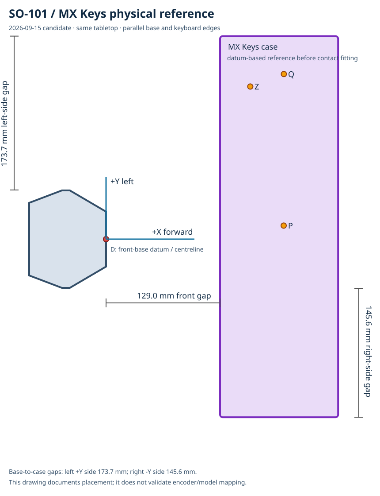

# September physical setup and checkpoint

Use a clamped SO-101 with the fixed typing jaw and a Logitech MX Keys keyboard.
The plastic robot base and keyboard sit directly on the **same flat table, with
no mat or riser**. Keep the moving jaw fully closed.

Measure the plastic base, excluding the clamp, motor cover and cable bracket.
Stand behind the robot, looking toward the keyboard:

| Placement | Reference |
| --- | --- |
| Front gap | About **130 mm (13 cm)** from the keyboard-facing flat base face to the nearest long keyboard **case edge** |
| Orientation | The nearest long keyboard edge is **parallel** to the base's front/back edges |
| Side alignment | Extend the base's short straight **right edge** toward the keyboard; it meets the bottom-right corner of **right Ctrl**, beside the left arrow |



The physical front gap was measured as approximately 130 mm; the drawing's
precise dimensions are model projections. Keep this physical placement fixed.
The checkpoint uses a separately fitted simulation pose and joint mapping;
see the [reference comparison](docs/fixtures/physical_reference_20260915.md#physical-reference-versus-fitted-training-scene).

## Released checkpoint

The September **`model_2498.pt`** uses AnchorBench actuators and Newton MJWarp.
It completed one supervised physical **NEWTON** trial with this setup.
`./so101 download` does not retrieve that bundle. The pinned dataset card does
not declare a license for it. Once a local copy is available under a declared
license, view it in simulation:

```bash
bundle=.artifacts/so101-keyboard-typing-benchmark/releases/calibrated-20260917
./so101 video --actuator anchorbench --stage transit15 \
  --checkpoint "$bundle/model_2498.pt" \
  --env-config "$bundle/params/env.yaml" --target NEWTON
```

Keep the checkpoint, matching `params/` folder and fitted
[joint-offset mapping](docs/release/HARDWARE_PREPARATION.md#joint-offsets-matching-the-simulated-scene-to-irl) together.
For physical use, complete your robot's own [LeRobot calibration](docs/release/HARDWARE_PREPARATION.md#install-and-calibrate)
and [alignment/deployment checks](docs/release/ALIGNMENT.md).

For a different placement, [measure your fixture](docs/release/TASK_CONFIGURATION.md#measure-your-fixture)
and follow [record → fit → train](docs/release/REAL2SIM.md).
