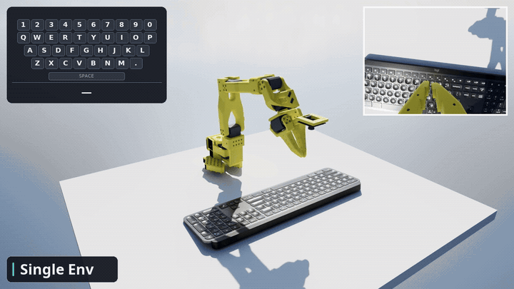
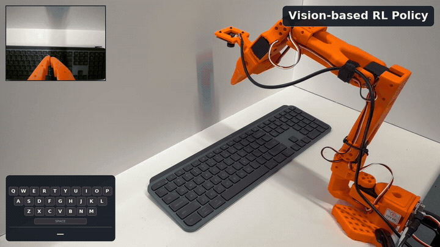

# SO-101 Typing RL Policy

| ISAAC LAB 3.0 · Single environment | Real world demo |
| :---: | :---: |
|  |  |

This project trains a vision-based PPO policy that uses wrist-camera images and joint observations to control an SO-101 robot typing on a keyboard.

Train a state teacher, then a wrist-camera policy for SO-101 keyboard typing.
This branch uses the GTC Berlin actuator model, Newton/MJWarp physics, and
OVRTX wrist images.

NOTICE AND DISCLAIMER: This software automatically retrieves, accesses or interacts with external materials. Those retrieved materials are not distributed with this software and are governed solely by separate terms, conditions and licenses. You are solely responsible for finding, reviewing and complying with all applicable terms, conditions, and licenses, and for verifying the security, integrity and suitability of any retrieved materials for your specific use case. This software is provided "AS IS", without warranty of any kind. The author makes no representations or warranties regarding any retrieved materials, and assumes no liability for any losses, damages, liabilities or legal consequences from your use or inability to use this software or any retrieved materials. Use this software and the retrieved materials at your own risk.

Component and asset terms are in [THIRD_PARTY_NOTICES.md](THIRD_PARTY_NOTICES.md).

## Requirements

Linux, Docker with NVIDIA Container Toolkit, and an RTX-capable NVIDIA GPU.
The interactive viewer needs an X11 desktop. See [runtime setup](docs/setup.md)
for hardware requirements, installation details, and headless operation.

## Install

```bash
git clone https://github.com/NVIDIA/so101-typing-task.git
cd so101-typing-task
./so101 setup
```

Optionally check that the viewer works:

```bash
./so101 debug --viewer
```

## Replay a checkpoint

The NEWTON and ISAAC LAB 3.0 weight files are not in this revision. Product
Legal has not approved their release terms. Provenance and the withheld
hashes are in [models/README.md](models/README.md). Replay a checkpoint from
a local training run:

```bash
./so101 replay --model /absolute/path/to/checkpoint.pt
```

Runs one simulated episode, then opens its **interactive RTX replay**.
It does not move a physical robot. See [checkpoint details](models/README.md).

[Advanced replay options](docs/replay.md) cover MP4 export, seeds and GPU selection.

## RTX examples

Each command runs a local **ISAAC LAB 3.0 state policy**, then opens its
animated RTX replay. The grid repeats the evaluated motion in each cell.
The commands require `models/isaac_lab_state/isaac_lab_ckpt.pt`, which is not
in this revision.

```bash
./scripts/view_recorded_tabletop_rtx.sh
./scripts/view_typing_grid_rtx.sh --rows 2 --cols 2
```

Use `SO101_VIEW_GPU=1` to select GPU 1; use `--rows 8 --cols 8` for an 8×8 grid.

## Train the state teacher, then the vision policy

```bash
./so101 train teacher --gpu 0
./so101 evaluate teacher --run output/teacher --suite random --gpu 0
./so101 train vision --teacher output/teacher --checkpoint best --gpu 0
./so101 evaluate vision --run output/vision --suite phrase --gpu 0
./so101 replay --run output/vision --checkpoint best --gpu 0
```

Training samples random **13-character strings** from A–Z, digits, space and
period. Vision evaluation targets **ISAAC LAB 3.0**. Configure training in
[default.json](configs/tutorial/default.json); start with the
[smoke test](docs/tutorial.md#2-run-a-short-end-to-end-installation-check).

## Workflow 1: Train for your setup

Calibrate your robot and keyboard before training for physical use:

- [Manual keyboard calibration](docs/release/TASK_CONFIGURATION.md#measure-your-fixture)
- [Calibration with GPT-6 Astra](docs/keyboard_calibration_astra.md)

After completing [hardware preparation](docs/tutorial.md#4-prepare-your-hardware):

```bash
./so101 hardware check --profile local/robot.json --model output/vision
./so101 deploy --profile local/robot.json --model output/vision
```

Deployment records cameras, telemetry and keyboard events, then returns to the
saved rest pose and verifies torque off. See [deployment instructions](docs/tutorial.md#5-check-and-deploy).

## Documentation

- [Training tutorial, evaluation and troubleshooting](docs/tutorial.md)
- [Policy architecture, observations, actions and rewards](docs/policy_architecture.md)
- [RTX replay and advanced options](docs/replay.md)
- [Runtime setup](docs/setup.md)
- [Checkpoint packaging](docs/tutorial_release.md)
- [Checkpoint trust and security boundaries](docs/security.md)

Generated runs and recordings stay under ignored `output/`. This revision does not track model weights.
