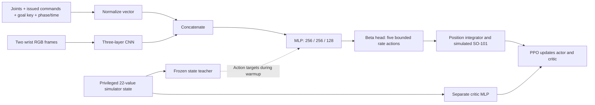

# Policy architecture

The actor sees 160×120 RGB at 25 Hz, stacking the previous and current images
into a `6×120×160` tensor. A three-layer CNN extracts 7,488 image features.
These are joined with a 45-value vector for A–Z, or a 57-value vector for the
38-key phrase vocabulary (A–Z, digits, space and period). The vector includes
five measured positions, five velocities, five issued commands, goal identity,
phase and elapsed phase time.

The actor produces five bounded joint-rate actions, integrated into persistent
joint-position commands every 40 ms. The separate critic receives the existing
22-value simulator state, including target XYZ. During warmup, the actor
learns to match the frozen teacher actions using mean squared error; the teacher
control probability falls from 100% to 50%. PPO rollouts then use only the
student actor. The teacher and critic are used only during training.

Rewards encourage moving toward the requested key, pressing it, releasing it,
and lifting clear before the next character. Smoothness and contact penalties
discourage abrupt or scraping motion. Full completion requires the exact target
sequence with release and clearance for every key. See
[the environment and reward definitions](../source/so101_typing/tasks/fixed_cartesian_env_cfg.py)
and [vision observations](../source/so101_typing/tasks/mdp/vision_observations.py).

Use an evaluated teacher that can already perform the target task. Imitation
helps initialize the vision policy, but 5,000 PPO updates remain a training
budget rather than a convergence guarantee.
